# STL output

Generated by `tools/build.sh` from `03-openscad/brewberrypi-case.scad`. Do not edit by hand.
Checked by `tools/check.sh`. Full output: [check-report.txt](check-report.txt).

Built from spec version: **0.8** (2026-10-22: back panel order aligned with the front, label HEATER).

## Files

| File | Part | Size (mm) | Print orientation (as exported) |
|---|---|---|---|
| [brewberrypi-case-body.stl](brewberrypi-case-body.stl) | body | 190 × 160 × 123 (+0.6 labels front/back) | upright, bottom edge on the bed |
| [brewberrypi-case-divider.stl](brewberrypi-case-divider.stl) | divider plate | 183.4 × 153.4 × 13 | upside down, standoffs and brackets pointing up |
| [brewberrypi-case-top_lid.stl](brewberrypi-case-top_lid.stl) | top lid | 186.6 × 156.6 × 3.8 | inner face on the bed, logo up |
| [brewberrypi-case-bottom_lid.stl](brewberrypi-case-bottom_lid.stl) | bottom lid | 190 × 160 × 7 | outer face on the bed, lip up |

All parts are designed to print **without supports** in one filament. Everything else (material, layer height,
infill, …) is up to your slicer. Bought parts: see spec §7 (M3 and M2.5 inserts/screws, brass Pi standoffs,
2 cable ties, 4 rubber feet).

## Previews

| | iso (front) | iso (back) | top | front |
|---|---|---|---|---|
| assembly | 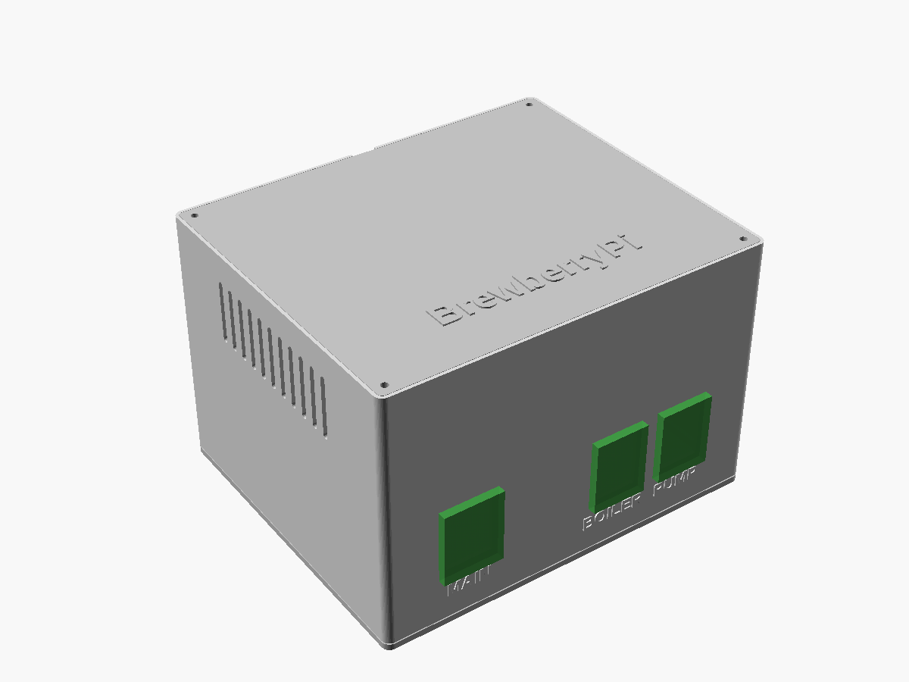 | 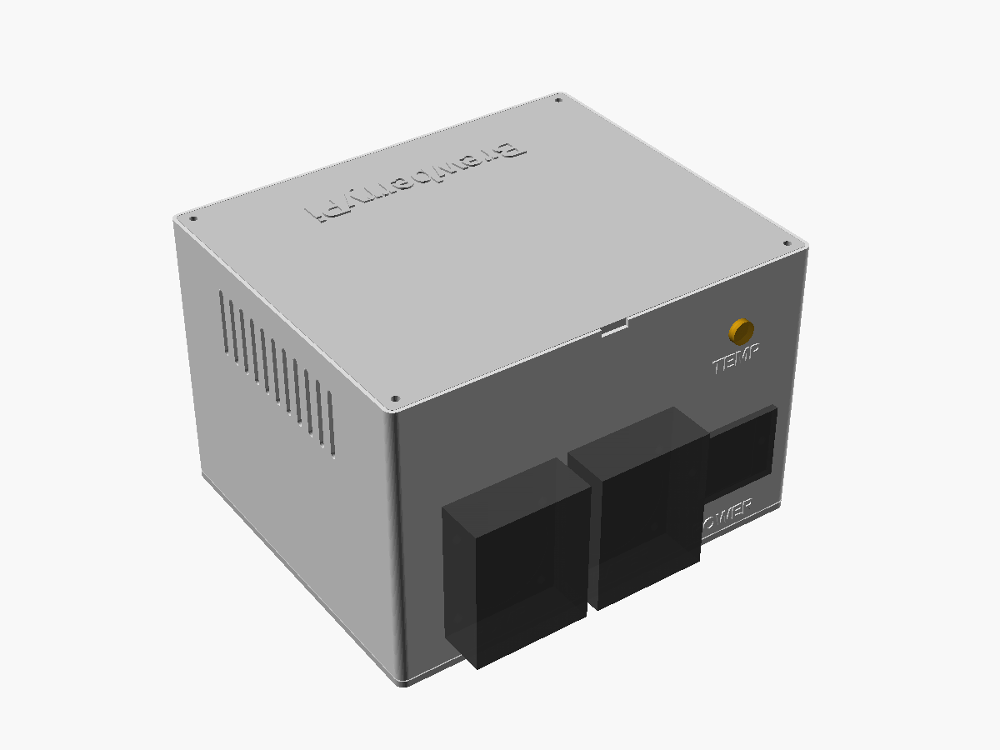 | 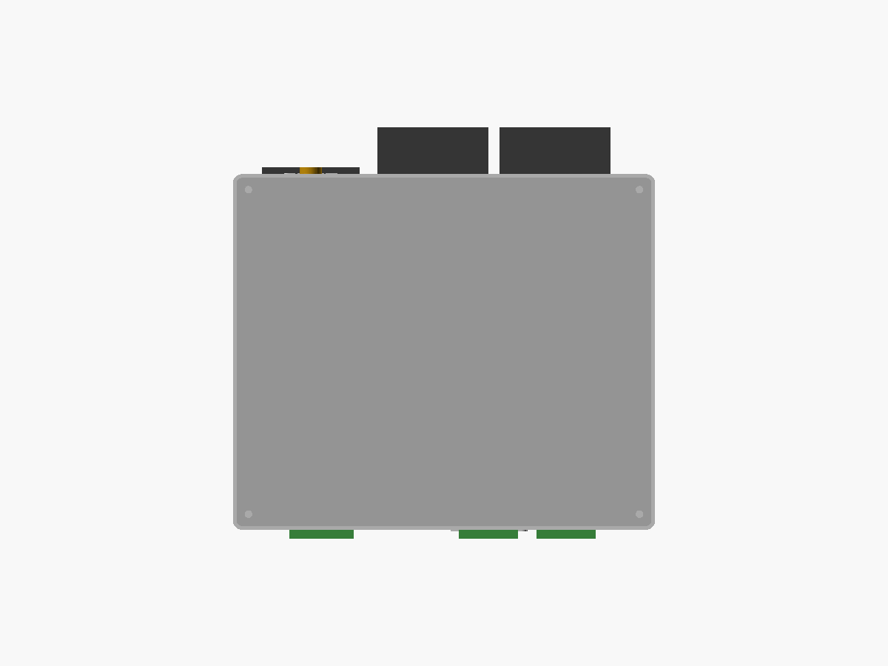 | 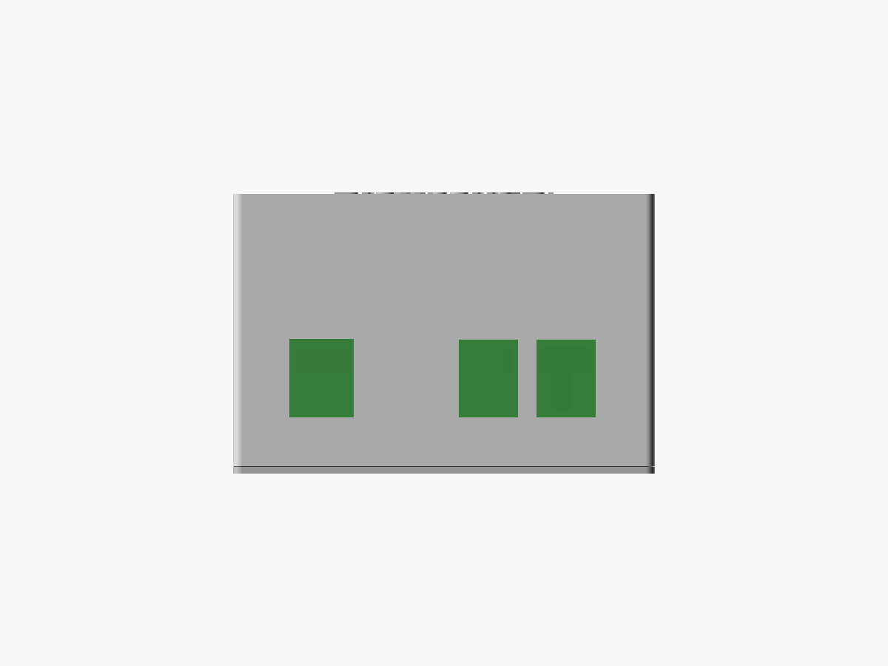 |
| body | 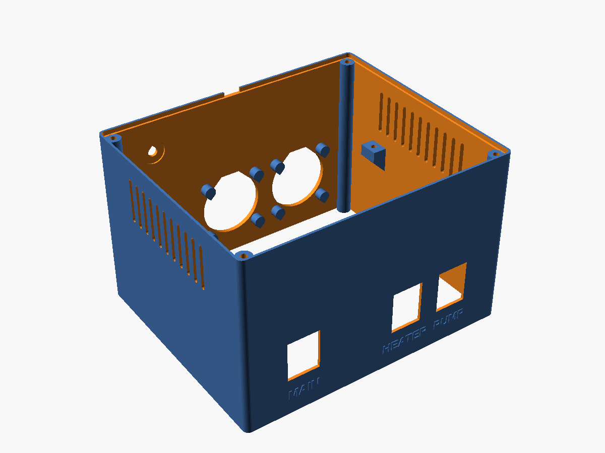 | 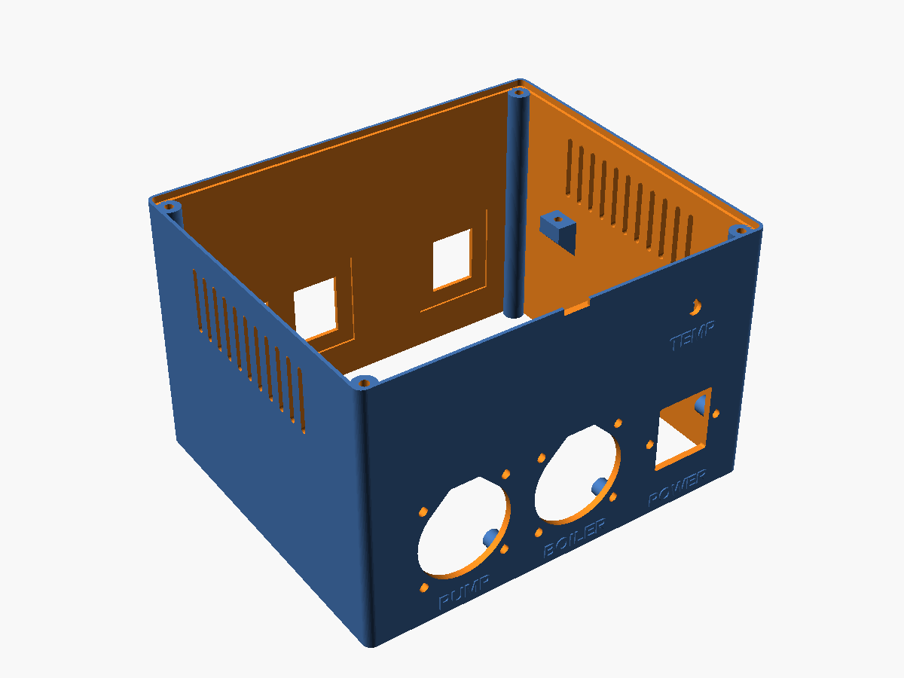 | 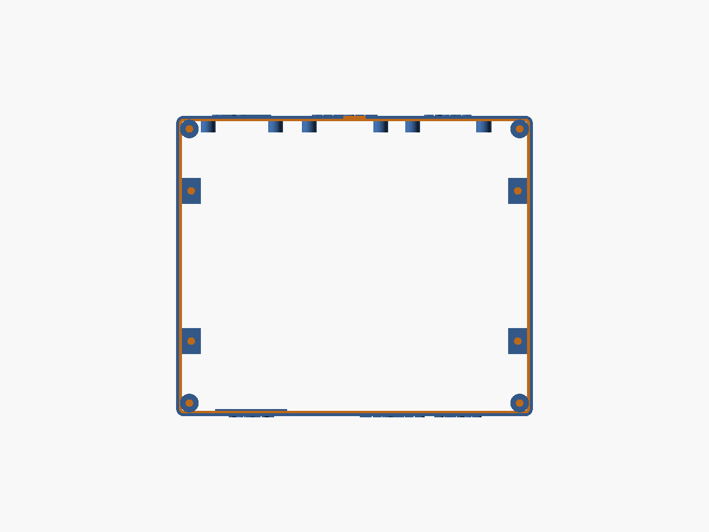 | 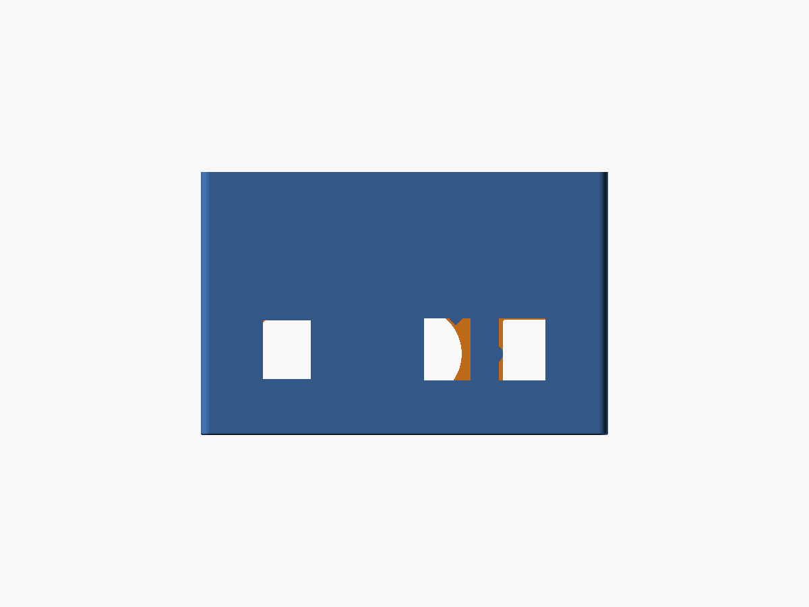 |
| divider | 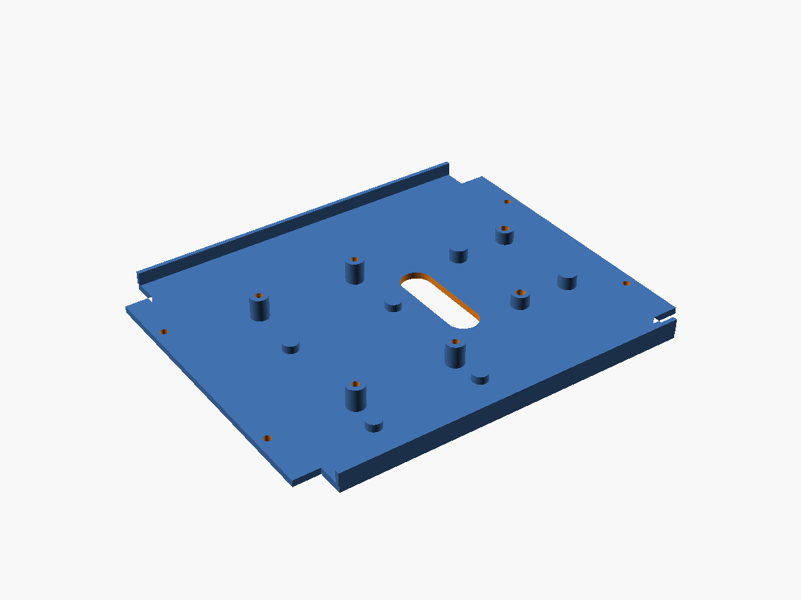 | 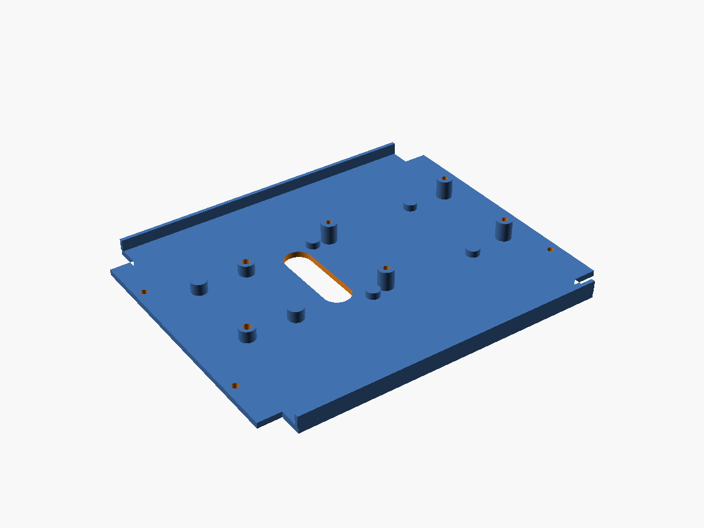 |  | 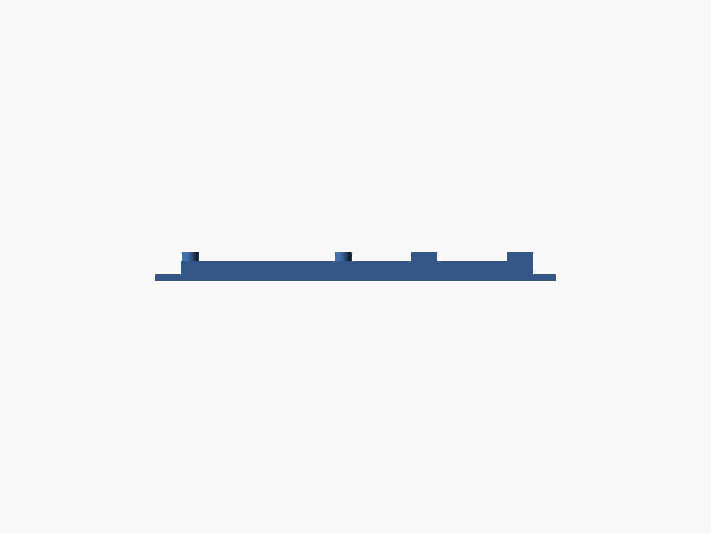 |
| top lid | 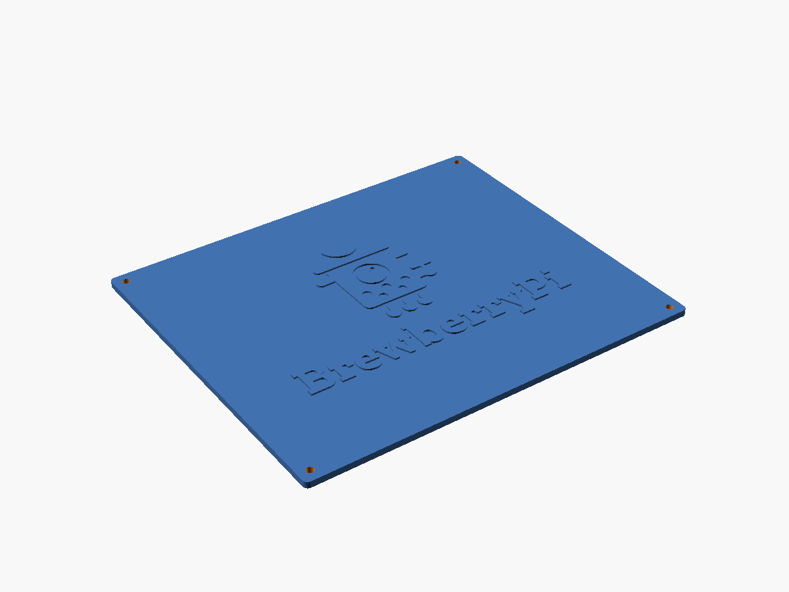 | 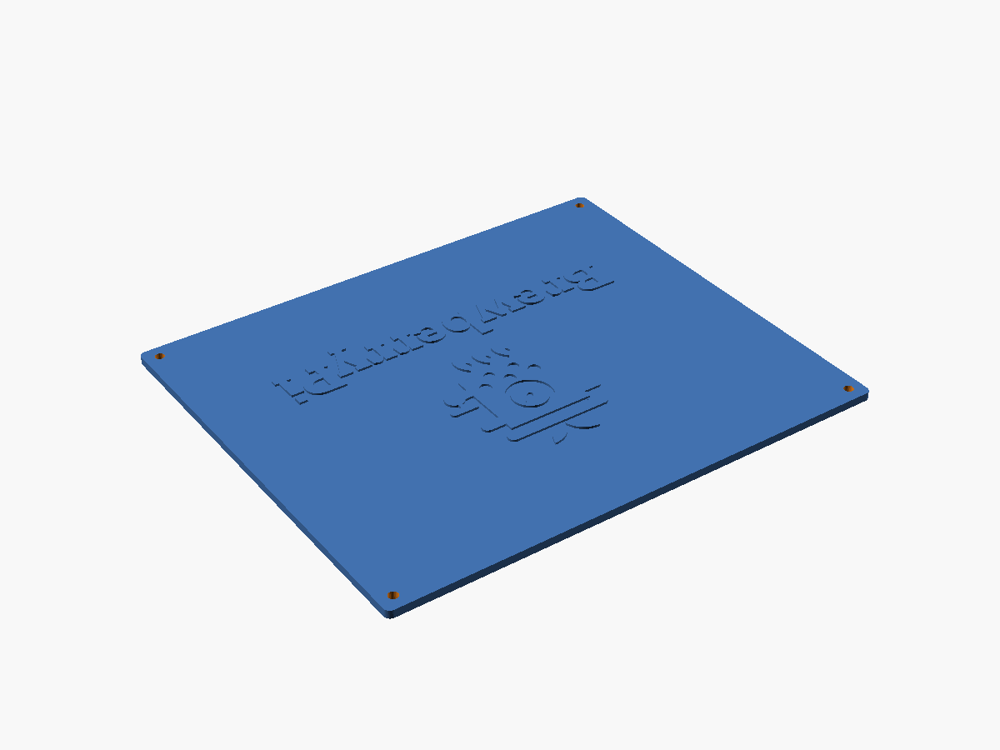 |  |  |
| bottom lid | 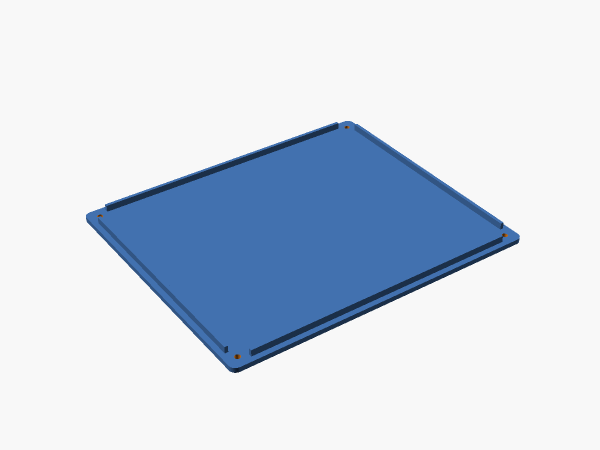 |  |  |  |

## Verification (spec §9)

| AC | Criterion | Result | Evidence |
|---|---|---|---|
| AC1 | Bounding boxes ≤ 200 mm, sizes as in §1 | ✅ pass | all four sizes as in the table above (`check.sh`, admesh) |
| AC2 | Every STL manifold | ✅ pass | 1 part each, 0 degenerate facets, 0 edges fixed, 0 facets added/removed, 0 backwards edges |
| AC3 | No collision between components and printed parts | ✅ pass | `part="collision_check"` renders empty: 10 component envelopes against all printed parts and against each other (45 pairs) |
| AC4 | Cutouts as in §5 (F3, F6, F7, F8) | ✅ pass | model report: MAIN 22.4 × 27.4, HEATER/PUMP 21.9 × 28.9 at x 40/115/150, z 40; IEC 27.9 × 31.9 r1 at x 35, z 38, screws 36; sockets Ø43.4 flat top at 24, HEATER x 90 / PUMP x 145, z 38, □38; jack Ø6.4 at x 35, z 98. Seen from the top, both panels read mains, heater, pump from the left (nominal + 0.2 clearance per side) |
| AC5 | Pi pattern 58 × 49 at F11, relay pattern below | ✅ pass | Pi holes (40.5/98.5, 58.5/107.5), relay holes (20/89, 61/110), directly under the Pi |
| AC6 | No overhang > 45° without a bridge | ✅ pass | `overhangs.py`: body: bridges over the IEC cutout (27.9), switch cutouts (21.9/22.4), socket flat tops (13.4), insert-hole ceilings (Ø4), vent slot tops (Ø3); 1 mm ledges at the switch and jack pockets; text undersides (0.6). Divider: insert-hole ceilings (Ø3.6). Lids: none |
| AC7 | Only M3 and M2.5 fastener features | ✅ pass | code review: holes come only from `insert_m3` (Ø4.0), `insert_m25` (Ø3.6) and `m3_clear` (Ø3.4) |
| AC8 | Labels raised 0.6 (logo 0.8), text ≥ 6 mm, readable from outside | ✅ pass | `labels.py`: capitals 6.12–6.29 mm, logo 12.04 mm, raised 0.60 / 0.80. Back labels read correctly from behind (body-iso-back) |
| AC9 | Print test: lids, divider and components fit | ⏳ open | needs your print |
| AC10 | Lid joints: 0.2 clearance, flush | ✅ pass | collision check: top lid in the rim, bottom lid lip in the walls, divider on the pads: all empty. Top lid 186.6 × 156.6 = rim inner outline − 0.2 per side |

## Still assumed (measure when the parts arrive)

| What | Parameter | Assumed |
|---|---|---|
| Relay board size / hole pattern | `relay_board`, `relay_holes` | 75 × 55 / 69 × 49 |
| USB-C adapter mounting hole | `adapter_screw` | none (cable ties) |
| Jack thread / max wall | `jack_d`, `jack_panel_t` | Ø6 / 2 mm |

Change the parameter in `03-openscad/brewberrypi-case.scad` (spec first), then run `tools/build.sh` and `tools/check.sh`.
